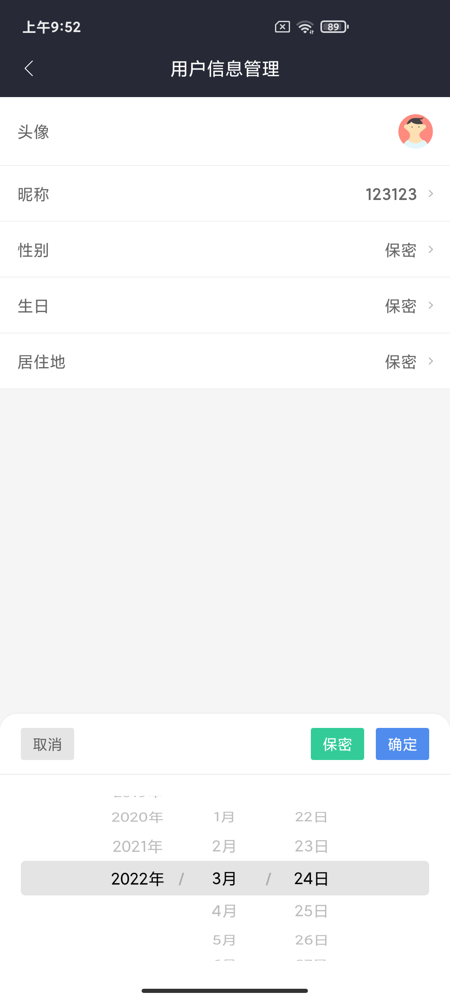
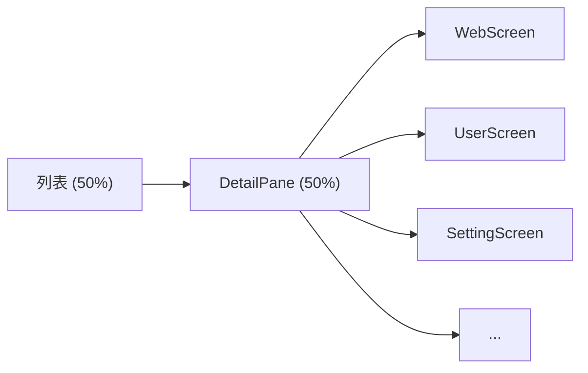

*Read this in [English](README.EN.md)*

## 架构文档

- [分层架构指南](docs/layering.md) —— 模块分层、依赖方向、feature 内部目录约定、守卫规则清单（**新增代码该放哪里**）
- [导航分层与新增导航指南](docs/navigation.md) —— NavKey、Navigator 契约、注册与跨域跳转
- [依赖策略与例外管理](docs/dependencies-policy.md) —— 新增模块门槛、core→core 矩阵、例外登记
- [架构决策记录（ADR）](docs/adr/0001-shared-protocol-model.md) —— 已定案且**不再重复论证**的议题：模型分层（`core:model` 为共享协议模型唯一落点）
- [应用内字体缩放方案](docs/font-scale.md) —— 字号滑块从 `LocalDensity` 覆盖到布局兼容、截图基线的完整决策链

## 前言
刚开始学习 `Kotlin` 其实挺痛苦的，相关的书籍或视频偏向于知识点的讲解，没有完整的项目实操。   
开源项目业务复杂，代码层层封装，用来上手实在不合适，于是便有了 `fragmject` 项目。   
在此感谢 [玩Android](https://www.wanandroid.com/) 及其提供 [开放API](https://wanandroid.com/blog/show/2) 。

## 简介
`fragmject` 是一个为初学者准备的上手项目。   
通过对 `Kotlin` 和 `Compose` 的系统运用，实现的一个功能完备符合主流市场标准应用。   
`fragmject` 没有复杂的业务和多余的封装， 完全依照 [Android Developer](https://developer.android.google.cn/) 官方的写法。   
代码简单，内容全面，快速上手，对理解其他项目设计思想和封装技巧也很有帮助。

### 技术栈
- **语言**：Kotlin 2.4.x + Compose
- **架构**：MVVM / MVI 混合，多模块（`core` + `feature` + `app`）
- **导航**：Navigation 3（`NavBackStack` + `NavDisplay`）
- **UI**：Material 3 + WindowSizeClass 大屏自适应
- **DI**：Hilt
- **数据库**：Room 3
- **网络**：Retrofit + OkHttp
- **构建**：Gradle Kotlin DSL + Version Catalog + Convention Plugins

学习本项目你将有如下收获：
- Kotlin + Compose 声明式 UI
- Navigation 3（类型安全导航 + List-Detail 同屏）
- WindowSizeClass 大屏/折叠屏自适应
- MVVM、MVI
- 常用控件封装（图片选择器、图片编辑器、日历控件、滚轮控件、全面屏沉浸、屏幕录制...）
- 字节码插桩（ASM...）

## 开发环境
- **JDK 21 及以上**：构建逻辑（`build-logic`）以 JVM 21 为目标编译，Gradle 需运行在 JDK 21 或更高版本上，低版本会在配置阶段报 `requires at least JVM runtime version 21`。Android Studio 请在 `Settings > Build Tools > Gradle` 中选择 `Android Studio default JDK`（内置 JBR 满足要求）；命令行请让 `JAVA_HOME` 指向 JDK 21+。项目未配置 toolchain 自动下载，也不强制某个精确版本。
- **Android SDK**：`compileSdkVersion` 为 37 + `compileSdkMinorVersion=1`（即 android-37.1，Compose 1.13 起要求 ≥ 37.1），`targetSdkVersion` 为 37，`minSdkVersion` 为 26（见 `config.properties`），需在 SDK Manager 中安装 **Android 37.1** 平台。
- **NDK 与 CMake**：`:security` 模块编译原生 so，需安装 NDK `28.2.13676358` 与 CMake `3.22.1`（见 `config.properties` 中的 `ndkVersion` / `cmakeVersion`）。
- **构建工具链**：Gradle 9.8.1（由 Wrapper 自动下载，无需本地安装）、AGP 9.5.1、Kotlin 2.4.21，版本统一维护在 `gradle/libs.versions.toml`。
- **签名配置**：仓库内的 `keystore.properties` / `keystore.key` 是**测试专用**密钥，入库为有意设计；正式发布请使用独立的私有签名。
- **CI**：`.github/workflows/ci.yml` 在 PR 与主分支上依次执行：凭据扫描、模块依赖守卫与 Compose 稳定性校验、单元测试、覆盖率报告与门槛、`lintDebug`、`detekt`、`assembleDebug`。

为了您能正常运行本项目，请先更新你的 `Android Studio` (可能需要梯子)。   
[Download Android Studio | Android Developer](https://developer.android.google.cn/studio?hl=zh-cn)   
您也可以自行配置 `AGP` 和 `compose`来进行适配。 [libs.versions.toml](https://github.com/miaowmiaow/fragmject/blob/master/gradle/libs.versions.toml)   

## 将 Android 应用迁移到版本目录
[将 build 迁移到版本目录 | Android Developer](https://developer.android.google.cn/studio/build/migrate-to-catalogs?hl=zh-cn)

## 前置知识
在学习前希望您能了解以下知识，这将帮助您更快的上手本项目。
- [Kotlin 语言学习 | Android Developer](https://developer.android.google.cn/kotlin/learn?hl=zh_cn)
- [Kotlin 代码示例 | Android Developer](https://play.kotlinlang.org/byExample/overview)
- [ViewModel 使用入门 | Android Developer](https://developer.android.google.cn/topic/libraries/architecture/viewmodel?hl=zh_cn)
- [Coroutines 使用入门 | Android Developer](https://developer.android.google.cn/kotlin/coroutines?hl=zh_cn)
- [Room 使用入门 | Android Developer](https://developer.android.google.cn/training/data-storage/room?hl=zh_cn)
- [Compose 使用入门 | Android Developer](https://developer.android.google.cn/jetpack/compose)

## 初学者建议

如果你更希望以较少的封装、更直白的代码快速上手，建议切换到 [v1.4.0](https://github.com/miaowmiaow/fragmject/tree/v1.4.0) 标签版本，该版本保留了更简洁的实现，没有复杂的架构分层与封装，更容易理解和学习。

## 截图展示
|  |  |  |
| ------------------------------------------------------------ |------------------------------------------------------------------------------------------|------------------------------------------------------------------------------------------|

## 项目目录结构
```
├── app                                             app 壳工程
|  └── src
|     └── main
|     |   ├── assets                                assets 目录（HTML/JS/JSON 测试数据）
|     |   └── java                                  源码目录
|     |      ├── MainActivity.kt                    唯一 Activity
|     |      ├── FragmjectApplication.kt            Application（Hilt 入口）
|     |      └── AppNavGraph.kt                     导航图（Navigation 3 + WindowSizeClass 自适应）
|     |
|     ├── build.gradle.kts                          模块构建配置
|     ├── dictionary                                自定义混淆字典
|     └── proguard-rules.pro                        代码混淆配置文件
| 
├── core                                            核心层（基础能力，不依赖业务）
|  ├── android-platform                             平台与进程级能力（AppScope / BaseContentProvider / File* / CacheUtils / UriPathUtils）
|  ├── data-contract                                数据端口契约（remote/local DataSource + HTTP 协议模型）
|  ├── data-repository                              数据实现（RepositoryImpl / PagingSource / Hilt 绑定）
|  ├── database                                     数据库（Room 3）
|  ├── designsystem                                 设计系统（AppTheme / WindowSizeClass / 颜色 / 间距，不含组件）
|  ├── domain                                       领域层（Repository 接口 + UseCase + DomainResult）
|  ├── image-editor                                 图片编辑引擎（画布 / 裁剪 / 编码 / 落盘）
|  ├── model                                        数据模型
|  ├── navigation-contract                          导航契约（语义 Navigator，跨 feature 解耦）
|  ├── navigation-runtime                           导航能力（Navigation 3 类型安全路由）
|  ├── network                                      网络层（Retrofit + OkHttp）
|  ├── qrscanner                                    扫码能力（CameraX / ML Kit）
|  ├── ui                                           UI 组件库（FeedCard / PagingSwipeRefreshBox 等）
|  └── webview                                      WebView 能力（池化 / 缓存 / CookieStore）
| 
├── feature                                         功能模块层（每个模块均含 api / impl 两个子模块）
|  ├── article                                      文章模块（WebView 详情 / 下载）
|  |  ├── api                                       API 层（NavKey 定义）
|  |  └── impl                                      实现层（Screen / ViewModel）
|  ├── auth                                         登录 / 注册
|  ├── authenticator                                动态口令（OTP 账户管理 / 密钥 Keystore 加密）
|  ├── collection                                   收藏 / 分享
|  ├── demo                                         组件 Demo（日历 / 滚轮 / 扫码 / 嵌套滚动等）
|  ├── home                                         首页（Home / Nav / Project / System / My）
|  ├── picture                                      图片模块（选择器 / 预览 / 编辑器）
|  ├── search                                       搜索
|  └── user                                         用户（主页 / 积分 / 排行 / 设置 / 历史）
| 
├── build-logic                                     构建逻辑（Gradle Convention 插件）
|  └── convention
|     └── src/main/kotlin
|        ├── FragmjectAndroidApplicationPlugin      application 约定插件
|        ├── FragmjectAndroidComposePlugin          compose 约定插件
|        ├── FragmjectKotlinParcelizePlugin         Kotlin Parcelize 能力插件
|        ├── FragmjectKotlinSerializationPlugin     Kotlin Serialization 能力插件
|        ├── FragmjectAndroidHiltPlugin             Hilt 约定插件
|        ├── FragmjectAndroidLibraryPlugin          library 约定插件
|        ├── FragmjectAndroidDependencyGuardPlugin  dependency 校验插件
|        └── FragmjectAndroidRoomPlugin             Room 约定插件
|
├── gradle
|  └── libs.versions.toml                           版本目录（统一依赖管理）
|
├── build.gradle.kts                                项目构建配置
├── config.properties                               项目配置
├── gradle.properties                               gradle 配置
└── settings.gradle.kts                             项目模块依赖配置
```

## 大屏自适应（WindowSizeClass）
项目基于 `material3-window-size-class` 实现了完整的大屏/折叠屏自适应布局。

### 布局策略
| 窗口尺寸 | 宽度 | 导航组件 | 详情展示 |
|---------|------|---------|---------|
| **Compact** | < 600dp | `NavigationBar`（底部导航栏） | 全屏推入 |
| **Medium** | 600–840dp | `NavigationDrawerItem` + `Surface`（左侧导航） | 全屏推入 |
| **Expanded** | ≥ 840dp | `PermanentNavigationDrawer`（常驻侧栏） | 右侧面板同屏 |

### 列表-详情同屏（List-Detail）
Expanded 模式下（平板横屏/桌面），点击文章、用户主页、系统设置等页面不再全屏跳转，而是在右侧面板渲染：



### 涉及文件
- [LocalWindowSizeClass.kt](core/designsystem/src/main/java/com/example/fragmject/core/designsystem/LocalWindowSizeClass.kt) — `CompositionLocal` 注入 + 便捷扩展
- [AppNavGraph.kt](app/src/main/java/com/example/fragmject/app/navigation/AppNavGraph.kt) — Expanded 模式拦截 `NavKey`，传递给 `DetailPane`
- [MainScreen.kt](feature/home/impl/src/main/java/com/example/fragmject/feature/home/ui/main/MainScreen.kt) — 三态布局分发 + `DetailPane` 路由

### 使用方式
```kotlin
val windowSizeClass = LocalWindowSizeClass.current
when (windowSizeClass.widthSizeClass) {
    WindowWidthSizeClass.Compact -> CompactLayout()
    WindowWidthSizeClass.Medium  -> MediumLayout()
    WindowWidthSizeClass.Expanded -> ExpandedLayout()
}
```

## Jetpack Compose
如果你暂时不需要 `Compose` ，可以切换到 Tags [v1.3.0](https://github.com/miaowmiaow/fragmject/tree/v1.3.0) 。

#### 更少的代码
与使用 `Android View` 系统相比，`Compose` 可让我们用更少的代码实现更多的功能，这样需要测试和调试的代码会更少，出现 bug 的可能性也更小。对于审核人员或维护人员，需要阅读、理解、审核和维护的代码就更少。   
`Compose` 的布局系统在概念上更简单，所有代码都使用同一种语言编写并且位于同一文件中，而不必在 `Kotlin` 和 `XML` 二者之间来回切换。

#### 直观
`Compose` 使用声明性API，这意味着您只需描述界面，`Compose` 会负责完成其余工作。   
利用 `Compose` ，您可以构建不与特定 `activity` 或 `fragment` 相关联的小型无状态组件。   
在 `Compose` 中，状态是显式的，并且会传递给相应的可组合项。这样一来，状态便具有单一可信来源，因而是封装和分离的。然后，应用状态变化时，界面会自动更新。

#### 相互兼容
`Compose` 与您所有的现有代码兼容：您可以从 `View` 调用 `Compose` 代码，也可以从 `Compose` 调用 `View` 。大多数常用库（如 `Navigation` 、 `ViewModel` 和 `Kotlin` 协程）都适用于 `Compose` ，因此您可以随时随地开始采用。

- [Jetpack Compose : 从改造你的登录页面开始](https://juejin.cn/post/7156425159249756191)
- [Jetpack Compose : 一学就会的自定义下拉刷新&加载更多](https://juejin.cn/post/7185159395519496250)
- [Jetpack Compose : 优雅的使用WebView](https://juejin.cn/post/7194360493866221628)
- [Jetpack Compose : 一文学会嵌套滚动NestedScrollConnection](https://juejin.cn/spost/7239610698116055098)
- [Jetpack Compose : 超简单实现滚轮控件(WheelPicker)](https://juejin.cn/post/7266702105829277754)
- [Jetpack Compose : 超简单实现文本展开和收起](https://juejin.cn/post/7317132381013082122)
- [Jetpack Compose : 超简单实现侧滑删除](https://juejin.cn/spost/7325259560523677747)
- [Jetpack Compose : 超简单实现侧滑删除（威力加强版）](https://juejin.cn/post/7350824272321314854)
- [Jetpack Compose : 使用 Compose Compiler Gradle 来设置 Compose](https://juejin.cn/post/7404130389985771546)

## WebView 优化及 H5 秒开实践
- [满满的 WebView 优化干货，让你的 H5 实现秒开体验](https://juejin.cn/post/7043706765879279629)
- [Jetpack Compose : 优雅的使用WebView](https://juejin.cn/post/7194360493866221628)


## SharedFlowBus
[SharedFlowBus：30行代码实现消息总线你确定不看吗](https://juejin.cn/post/7028067962200260615)

#### 快速使用
```
// 发送消息
SharedFlowBus.with(objectKey: Class<T>).tryEmit(value: T)

// 发送粘性消息
SharedFlowBus.withSticky(objectKey: Class<T>).tryEmit(value: T)

// 订阅消息
SharedFlowBus.on(objectKey: Class<T>).observe(owner){ it ->
    println(it)
}

// 订阅粘性消息
SharedFlowBus.onSticky(objectKey: Class<T>).observe(owner){ it ->
    println(it)
}
```

## 字节码插桩
[最通俗易懂的字节码插桩实战 —— 优雅的打印方法执行时间](https://juejin.cn/post/6986848837797658637)

[最通俗易懂的字节码插桩实战 —— 自动埋点](https://juejin.cn/post/6985366891447451662)

> 字节码插桩相关源码（`library-plugin` / `MiaowPlugin`）已从当前分支移除，如需查看完整实现，请切换到 Tags [v1.3.0](https://github.com/miaowmiaow/fragmject/tree/v1.3.0)。

#### 隐私合规 ———— 替换目标字段或方法（library-plugin）
[一文学会字节码替换，再也不用担心隐私合规审核](https://juejin.cn/post/7121985493445083149)

#### 源码位置
```
├── library-plugin                              
|  └── src 
|     └── main 
|        ├── kotlin                             
|        └── resources                          
|           └── statistic.properties            插件配置
| 
└── repos                                       插件生成目录                  
```

#### 快速使用
在 `MiaowPlugin` 添加 `ScanBean` 并配置目标字段或方法以及对应的替换字段或方法。
```
ScanBean(
    owner = "android/os/Build",
    name = "BRAND",
    desc = "Ljava/lang/String;",
    replaceOpcode = Opcodes.INVOKESTATIC,
    replaceOwner = "com/example/fragment/library/common/utils/BuildUtils",
    replaceName = "getBrand",
    "()Ljava/lang/String;"
)
```

#### 耗时扫描 ———— 打印方法执行时间
在 `MiaowPlugin` 添加 `TimeBean` 并配置打印目标或范围。
```
TimeBean( //以包名和执行时间为条件
    "com/example/fragment/library/base",
    time = 50L
)
```

#### 埋点统计 ———— 自动埋点
在 `MiaowPlugin` 添加 `TraceBean` 并配置埋点目标以及对应埋点方法。
```
TraceBean(
    owner = "Landroid/view/View\$OnClickListener;",
    name = "onClick",
    desc = "(Landroid/view/View;)V",
    traceOwner = "com/example/fragment/library/common/utils/StatisticHelper",
    traceName = "viewOnClick",
    traceDesc = "(Landroid/view/View;)V" //参数应在desc范围之内
)
```
配置完成后 `gradle` 执行 `publish` 任务生成插件。   
在根目录 `setting.gradle` 添加本地插件源。
```
pluginManagement {
    repositories {
        maven {
            url uri('repo')
        }
    }
}
```
在根目录 `build.gradle` 添加插件依赖。
```
buildscript {
    dependencies {
        classpath 'com.example.miaow:plugin:1.0.0'
    }
}
```
在app目录 `build.gradle` apply插件。
```
plugins {
    id 'miaow'
}
```

## 图片编辑器（core:image-editor + feature/picture）
[自己动手撸一个图片编辑器（支持长图）](https://juejin.cn/post/7013274417766039560)（早期实现的文章，当前 API 已变化，以下示例以现有代码为准）

### 截图展示
|  |  |  |
|-------------------------------------------------------------------------------------------|------------------------------------------------------------------------------------------|------------------------------------------------------------------------------------------|

### 模块结构
- **`core:image-editor`**：图片编辑引擎，不依赖业务。
  - `ImageEditorEngine`：加载位图（路径或 Uri），并保存编辑结果。`save(bitmap)` 返回 `SaveResult`（缓存文件路径与相册 uri）。
  - `components`：Compose 画布。`PictureEditorCanvas`（涂鸦 / 马赛克 / 贴纸）与 `PictureClipCanvas`（裁剪），分别配套 `rememberPictureEditorState()` 与 `rememberPictureClipState()` 状态。
- **`feature/picture`**：页面与路由，`api` 只含路由（NavKey），`impl` 含页面实现。
  - 路由：`PictureSelectorNavKey`（选择器）、`PicturePreviewNavKey`（预览，可多选）、`PictureEditorNavKey(oldUriString)`（编辑）。
  - 页面：`PictureSelectorScreen`、`PictureEditorScreen`。
- 其他 feature 通过 `core:navigation-contract` 的 `PictureNavigator` 进入图片流程，不直接依赖 `feature:picture:impl`。

```
core/image-editor/src/main/java/com/example/fragmject/core/image/editor
├── ImageEditorEngine.kt      引擎接口与默认实现（加载 / 保存）
├── components                Compose 画布（编辑 / 裁剪）与各图层
└── model                     贴纸、涂鸦路径等数据模型
```

### 编辑工具
| 工具 | 模式 | 说明 |
|---|---|---|
| 涂鸦 | `EditorMode.GRAFFITI` | 可设置画笔颜色，支持撤销 |
| 马赛克 | `EditorMode.MOSAIC` | 支持撤销 |
| 贴纸 | `EditorMode.STICKER` | 添加、拖动，拖到回收站删除 |
| 裁剪 | `PictureClipCanvas` | 旋转、重置，保存裁剪框内的图片 |

### 快速使用（Compose）
```kotlin
val editorState = rememberPictureEditorState()

// 1. 设置底图（路径或 Uri 二选一）
LaunchedEffect(path) { editorState.setBitmapPathOrUri(path, null) }

// 2. 放置画布
PictureEditorCanvas(state = editorState, modifier = Modifier.fillMaxSize())

// 3. 编辑操作
editorState.setMode(EditorMode.GRAFFITI)
editorState.setGraffitiColor(android.graphics.Color.WHITE)
editorState.setSticker(StickerAttrs(bitmap))
editorState.graffitiUndo()
editorState.mosaicUndo()

// 4. 导出编辑后的位图（如需落盘，交给 ImageEditorEngine.save）
val edited: Bitmap? = editorState.saveBitmap()
```
如上所示：
1. 通过 `setBitmapPathOrUri(path, uri)` 传入底图，路径与 Uri 二选一。
2. 通过 `setMode(mode)` 切换编辑模式：涂鸦、马赛克、贴纸。
3. 通过 `setGraffitiColor(color)` 设置涂鸦颜色，通过 `setSticker(StickerAttrs(bitmap))` 添加贴纸。
4. 通过 `graffitiUndo()` / `mosaicUndo()` 分别撤销涂鸦与马赛克。
5. 通过 `saveBitmap()` 获取编辑后的位图。

#### 图片裁剪（Compose）
```kotlin
val clipState = rememberPictureClipState()
clipState.setBitmap(bitmap)

PictureClipCanvas(state = clipState, modifier = Modifier.fillMaxSize())

clipState.rotate()
clipState.reset()
val cropped: Bitmap? = clipState.saveBitmap()
```

#### 进入图片流程
在 feature 中注入 `PictureNavigator`（`core:navigation-contract`）后调用：
```kotlin
pictureNavigator.openPictureSelector()
pictureNavigator.openPictureEditor(uriString)
```

## Calendar


#### 源码位置
```
└── feature
    └── demo
       └── impl
          └── ui
             └── calendar
                └── CalendarScreen.kt
```

#### 快速使用
```
val calendarState = rememberCalendarState()
calendarState.addSchedule(text)

Calendar(
    state = calendarState,
    modifier = Modifier.padding(vertical = 15.dp),
    onSelectedDateChange = { y, m, d ->
        println("CalendarScreen: $y - $m - $d")
    }
)
```

## 本地复现 CI

CI 执行的步骤都能在本地跑（与 `.github/workflows/ci.yml` 一致），排查失败时按顺序执行：

```bash
# 需要 JDK 21+；macOS 上可直接用 Android Studio 自带的 JBR
export JAVA_HOME="/Applications/Android Studio.app/Contents/jbr/Contents/Home"

# 1. 架构守卫：依赖方向 + Compose 稳定性（与单测分开执行只为失败时定位更快，两者都兼容配置缓存）
./gradlew verifyModuleDependencies verifyComposeStabilityConfig

# 2. 单元测试（含 app 模块的 33 条架构规则，类名以 Architecture 开头）
./gradlew testDebugUnitTest

# 3. 覆盖率报告与门槛（AGP 9 已移除内置覆盖率，由 build-logic 的 JaCoCo 配置提供）
./gradlew unitTestCoverageReport verifyUnitTestCoverage
# 报告：<module>/build/reports/jacoco/unitTestCoverageReport/html/index.html

# 4. Lint（无 baseline：新增 error 会阻断，warning 只报告）
./gradlew lintDebug
# 报告：<module>/build/reports/lint-results-debug.html

# 5. detekt 静态分析
./gradlew detekt

# 6. 打包链路（资源合并 / R8 / NDK / 签名）
./gradlew assembleDebug
```

排障提示：

- `Unable to locate a Java Runtime` → `JAVA_HOME` 未设置，见上面第一行。
- Lint 报 `Aborting build since new baseline file was created` → 该模块被配置了 baseline 但文件不存在。本工程已统一不使用 baseline，出现该提示说明有新模块误配，检查 `build-logic` 的 lint 约定。
- 覆盖率报告为空或 0% → 检查 AGP 升级后 Kotlin 编译产物路径是否变化（见 `ProjectExtensions.configureUnitTestCoverage` 里的注释）。

## 主要开源库
- [coil-kt/coil](https://github.com/coil-kt/coil)
- [google/gson](https://github.com/google/gson)
- [square/okhttp](https://github.com/square/okhttp)
- [square/retrofit](https://github.com/square/retrofit)

完整的第三方组件、版本与许可证清单见 [docs/third-party-licenses.md](./docs/third-party-licenses.md)。

## Gitee镜像
- [fragmject](https://gitee.com/zhao.git/FragmentProject.git)

## About me
- QQ群 : 389499839
- JueJin：[miaowmiaow](https://juejin.cn/user/3342971112791422/posts)

## Thanks
感谢所有优秀的开源项目 ^_^   
如果喜欢的话希望给个 Star 或 Fork ^_^  
谢谢~~  
